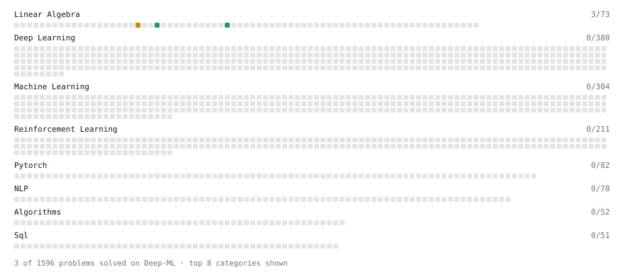

# Deep-ML

My machine learning practice from [Deep-ML](https://www.deep-ml.com). Every solution here was written by hand.

**8** solved · 6 problems · 0 labs · 2 math

[**Browse the interactive portfolio**](https://Chitwan54.github.io/deep-ml/) to replay this filling in over time.

## Problems

| | Difficulty | Solved | |
| --- | --- | --- | --- |
| [Implement Orthogonal Projection of a Vector onto a Line](https://www.deep-ml.com/problems/66) | easy | 2026-10-18 | [solution](problems/0066-implement-orthogonal-projection-of-a-vector-onto-a-line) |
| [Linear Regression Using Normal Equation](https://www.deep-ml.com/problems/14) | easy | 2026-10-18 | [solution](problems/0014-linear-regression-using-normal-equation) |
| [Matrix Determinant & Trace](https://www.deep-ml.com/problems/195) | easy | 2026-10-10 | [solution](problems/0195-matrix-determinant-trace) |
| [Chain Rule for Composite Functions](https://www.deep-ml.com/problems/214) | medium | 2026-10-20 | [solution](problems/0214-chain-rule-for-composite-functions) |
| [Gaussian Elimination for Solving Linear Systems](https://www.deep-ml.com/problems/58) | medium | 2026-10-10 | [solution](problems/0058-gaussian-elimination-for-solving-linear-systems) |
| [Linear Regression - Power Grid Optimization](https://www.deep-ml.com/problems/92) | medium | 2026-10-19 | [solution](problems/0092-linear-regression-power-grid-optimization) |

## Math

| | Difficulty | Solved | |
| --- | --- | --- | --- |
| [Why Minibatches: Gradient Variance vs Batch Size](https://www.deep-ml.com/math-problems/130) | easy | 2026-10-20 | [solution](math/0130-why-minibatches-gradient-variance-vs-batch-size) |
| [Multivariate Calculus](https://www.deep-ml.com/math-problems/2) | medium | 2026-10-19 | [solution](math/0002-multivariate-calculus) |

---

_This file is regenerated by Deep-ML on every push._
